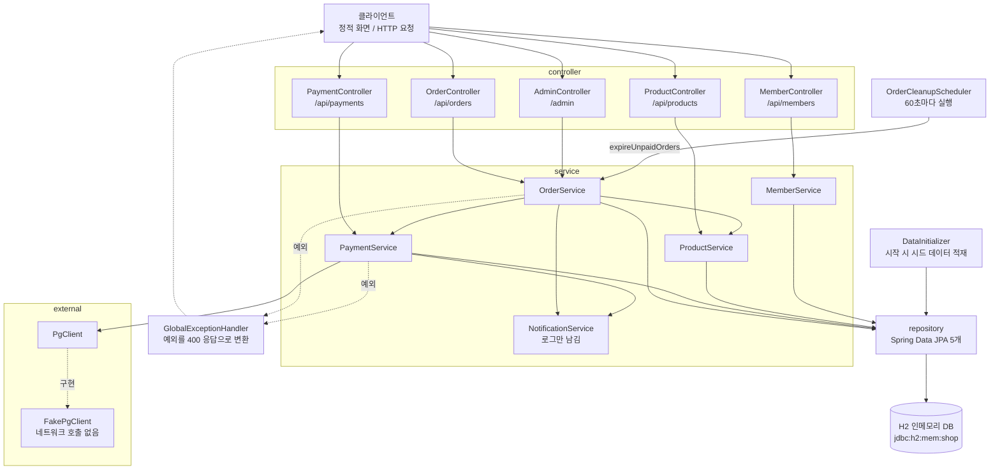

# 아키텍처

컨트롤러에서 데이터베이스까지의 요청 흐름과 스케줄러, 결제(PG) 연동을 한 장으로 정리한 문서입니다. 소스 코드에서 확인한 호출 관계만 그렸습니다. 서버를 실행해서 확인한 것은 아닙니다.

## 다이어그램 읽는 법

- **요청 경로**: 클라이언트 → 컨트롤러 → 서비스 → 리포지토리 → H2. 컨트롤러는 서비스만 호출하고 리포지토리를 직접 부르지 않습니다.
- **주문 서비스가 중심**: `OrderService`는 `PaymentService`(환불), `ProductService`(재고 복구), `NotificationService`(알림)를 호출합니다. 주문 관련 컨트롤러는 `OrderController`와 `AdminController` 둘 다 `OrderService`로 갑니다.
- **결제 연동**: `PaymentService`가 `PgClient` 인터페이스로 승인(`approve`)과 취소(`cancel`)를 요청합니다. 구현체는 `FakePgClient` 하나뿐입니다.
- **스케줄러**: `OrderCleanupScheduler`는 컨트롤러를 거치지 않고 `OrderService.expireUnpaidOrders()`를 직접 호출합니다. 간격은 60초이고 첫 실행은 시작 60초 뒤입니다.
- **예외 처리**: 서비스가 던진 `IllegalArgumentException`(`E400`)과 `IllegalStateException`(`E409`)을 `GlobalExceptionHandler`가 HTTP 400 응답으로 바꿉니다.
- **시드 데이터**: `DataInitializer`는 서버 시작 시 리포지토리로 회원, 상품, 주문, 결제 데이터를 넣습니다.

## 표기상 생략한 것

- 리포지토리 5개(Member, Order, OrderItem, Payment, Product)는 노드 수를 줄이려고 하나로 묶었습니다. 서비스별로 어떤 리포지토리를 쓰는지까지는 그리지 않았습니다.
- 엔티티, DTO, `util` 패키지, `ApiResponse`는 흐름 설명에 필요하지 않아 뺐습니다.
- 다이어그램 렌더링은 Mermaid 렌더러에서 직접 확인하지 못했습니다. 문법만 검토했습니다.
